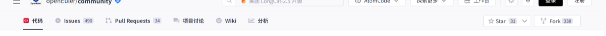
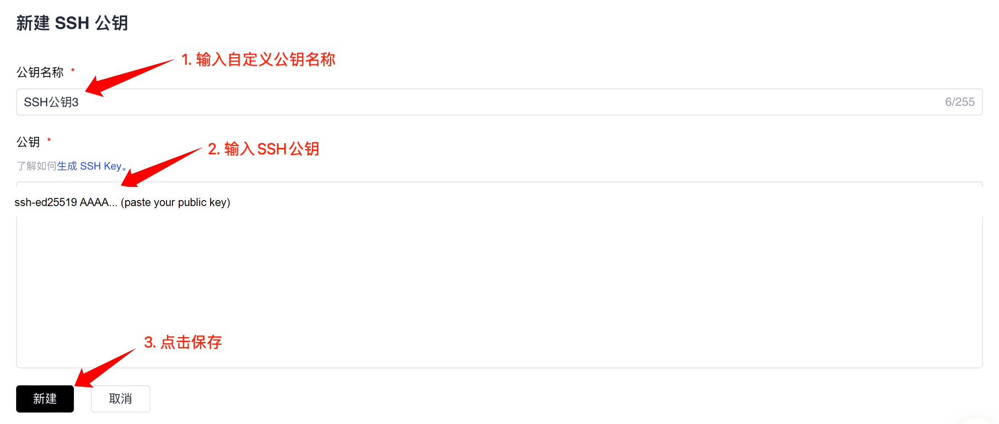
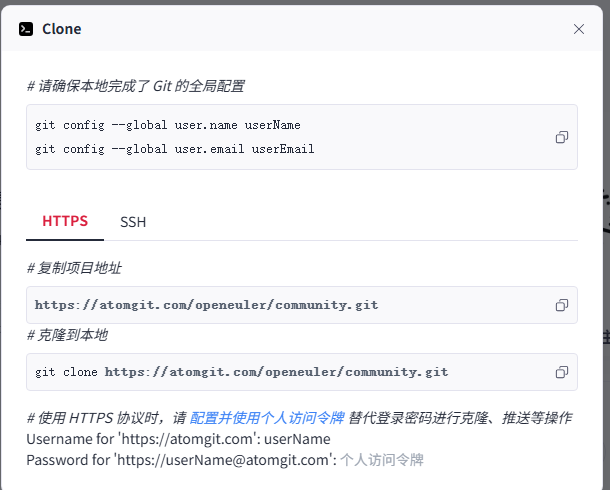
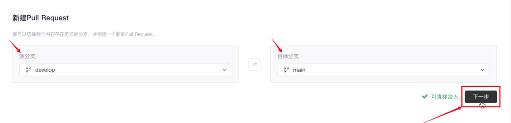
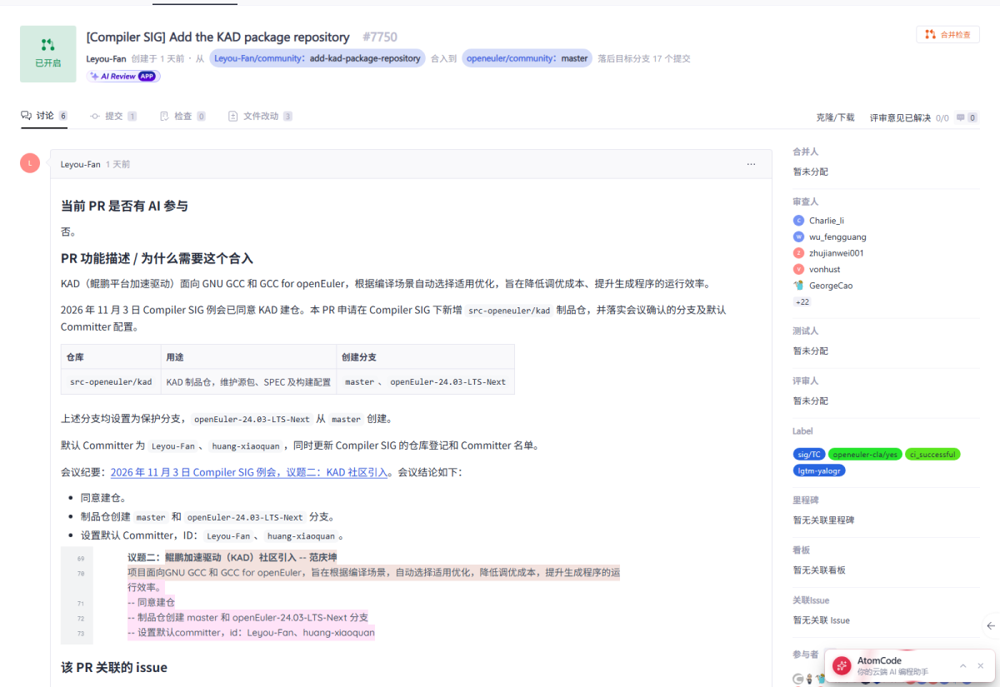
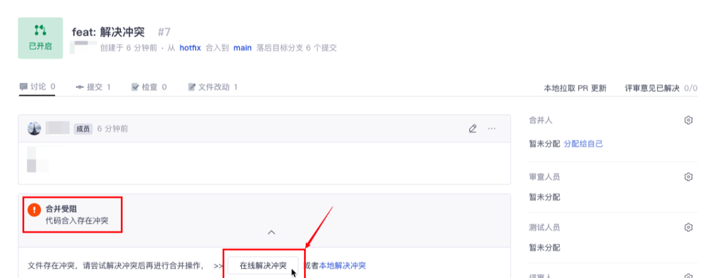

# 代码托管工作流说明

> 说明：openEuler 当前使用的代码托管平台为 AtomGit。本文档中的界面、域名和命令均以 AtomGit 为例。

### 1、开展工作流前的准备

- 安装Git：请先确保您的电脑上已经安装了Git软件。如您需了解Git，可以在Google、baidu或其他搜索引擎上求助相关内容。
- 在开始工作流之前，您需要先在openEuler的代码托管平台上找到您感兴趣的Repository。如果您还未找到对应的Repository，请参考[此章节的内容](README.md/#找到您感兴趣的工作)。


### 2、从云上fork代码分支

1. 找到并打开对应的repository的首页
2. 点击右上角的 `Fork` 按钮，按照指引，建立一个属于**“个人”**的云上fork分支。详细操作请参考[Fork工作流](https://docs.atomgit.com/docs/help/home/org_project/pullrequests/pr-fork)。


### 3、把fork分支复制到本地

请按照以下的复制过程将repository内的代码下载到您的计算机上。

1、**创建本地工作目录**：

您需要创建本地工作目录，以便于本地代码的查找和管理

```
mkdir -p /YOUR_PATH/src/${your_working_dir}
```

> 说明：如果您已经在 openEuler 上做过开发，可以将工作目录放在现有的源码目录下。


2、**完成git上用户名和邮箱的全局配置**（如果您之前已经完成过此项配置，请忽略）

把git上的 `user` 设置成您在代码托管平台的个人名称：

```
git config --global user.name "your Name"
```

配置您的git邮箱

```
git config --global user.email "email@your_email"
```


3、**完成SSH公钥注册（如果您没有完成此注册，每次都要重新输入账户和密码）**

- ① 生成ssh公钥

  ```
  ssh-keygen -t rsa -C "email@your_email"
  cat ~/.ssh/id_rsa.pub
  ```

- ② 登录您个人的代码托管平台账户并添加您的ssh公钥

  请在代码托管平台网页点击右上角的“个人头像”进入“个人设置”，在“个人设置 -> 安全设置”下点击“SSH 公钥”，在“+ SSH 公钥”内把cat命令获取到的ssh公钥添加进去。详细操作请参考[SSH 公钥管理](https://docs.atomgit.com/docs/help/home/user_center/security_management/ssh)。

  

  在个人电脑上完成SSH登记

  ```
  ssh -T git@atomgit.com
  ```

  如果获得类似“Welcome to ...”的欢迎信息，则表示 SSH 公钥已经生效。


4、**复制远程仓库到本地**

- ① **切换到本地路径**

  ```
  mkdir -p $working_dir
  cd $working_dir
  ```

- ② **复制远程仓库到本地**

  - 请注意openEuler有几个组织，请确认您所下载的远程仓库的组织名称

  - 您可以在repository内点击“克隆/下载”按钮，复制远程仓库的拷贝地址，得到`$remote_link`：

    

  - 在本地电脑执行拷贝命令：

    ```
    # 把远程 fork 仓库复制到本地
    git clone https://atomgit.com/$user_name/$repository_name

    # 设置本地工作目录的 upstream 源（被 fork 的上游仓库）
    git remote add upstream https://atomgit.com/openeuler/$repository_name

    # 设置同步方式，此处
    git remote set-url --push upstream no_push
    ```


### 4、拉分支

更新您的本地分支

```
git fetch upstream
git checkout master
git rebase upstream/master
```

从这里拉分支:

```
git checkout -b myfeature
```

然后在 `myfeature` 分支上编辑和修改代码。


### 5、本地构建和验证

本地构建的具体方法，请参考所在repository内提供的相关文档，获取方式请参考[此章节](README.md/#id2-2-3)内容。


### 6、保持您的分支和master的同步

```
# While on your myfeature branch
git fetch upstream
git rebase upstream/master
```

执行merge的时候，请不要使用 `git pull` 替代上面的 `fetch` / `rebase`。因为这种方式会使提交历史变得混乱，并使代码更难被理解。您也可以通过更改 `.git/config` 文件，例如执行 `git config branch.autoSetupRebase always` 来改变 `git pull` 的行为。


### 7、在本地工作目录提交变更

提交您的变更

```
git add .
git commit -m "提交原因"
```

您可能会在前次提交的基础上，继续编辑构建并测试更多内容，可以使用 `commit --amend` 继续添加提交。


### 8、将变更推送到你的远端目录

准备进行审查（或只是建立工作的异地备份）时，将分支推到你在代码托管平台的fork分支:

```
git push -f origin myfeature
```


### 9、创建一个 pull request

1. 访问你在 `https://atomgit.com/$user/$repository_name` 的页面

2. 把您的分支选到您提交使用的 `myfeature` 分支上，点击「新建 Pull Request」。详细操作请参考[创建 Pull Request](https://docs.atomgit.com/docs/help/home/org_project/pullrequests/pr-create)。

3. 在创建新PR界面，确认源分支和目标分支，选择创建。

   

4. 提交PR是对项目上的master的一次合入，为保证合入的质量，这个动作是需要小心谨慎的，您可以查看[pull-request](pull-request.md)，该文档有对提交PR的更加具体的指导和建议，以帮助您提交的PR正确和更加快速地获得响应和合入。

*另外，如果您具有上游写访问权*，请不要使用平台 UI 创建PR，因为平台会在主存储库而不是您的fork中创建PR分支。


### 10、查看和回应代码审查意见

#### 查看代码检视意见

你提交PR申请后，PR被分配给一个或多个检视者。这些检视者将进行彻底的代码检视，以确保提交的正确性，不仅包括代码的正确，也包括注释和文档等。

您可以在PR列表内找到您提交的PR，并看到对该PR的评论和评审意见。代码托管平台的代码审查操作可参考[代码审查](https://docs.atomgit.com/docs/help/home/org_project/pullrequests/pr-code-review)。



**小的PR很容易检视。量级较大的PR很难被正确地检视。**


### 回退一个提交

如果你想回退提交，请采用下面的方式

*如果您具有上游写访问权限*，请不要使用`Revert` 平台 UI中的按钮创建PR，因为平台会在主存储库而不是您的fork中创建PR分支。

- 创建一个分支并用upstream进行同步

  ```
  # create a branch
  git checkout -b myrevert

  # sync the branch with upstream
  git fetch upstream
  git rebase upstream/master
  ```

- 如果您希望还原的提交是:

  - **merge commit:**

    ```
    # SHA is the hash of the merge commit you wish to revert
    git revert -m 1 SHA
    ```

  - **single commit:**

    ```
    # SHA is the hash of the single commit you wish to revert
    git revert SHA
    ```

- 这将创建一个新的提交以回退到更新前。push这次提交到远程工作目录

```
git push ${your_remote_name} myrevert
```

- 用这个分支创建一个PR。具体操作可参考[Revert](https://docs.atomgit.com/docs/help/home/org_project/pullrequests/pr-revert)。


### 处理提交冲突

如果您发现提交的PR带有冲突标记，说明您提交的PR和您本地存在冲突，您需要处理冲突。具体操作可参考[解决冲突](https://docs.atomgit.com/docs/help/home/org_project/pullrequests/pr-sovle-conflict)。



1、先将分支切换到master上，并完成master的rebase

```
git checkout master
git fetch upstream
git rebase upstream/master
```

2、再将分支切换到您使用的分支上，并开始rebase

```
git checkout yourbranch
git rebase master
```

3、此时您可以在git上看到冲突的提示，你可以通过vi等工具查看冲突

4、解决冲突以后，再把修改提交上去

```
git add .
git rebase --continue
git push -f origin yourbranch
```


# 合并提交

如果您提交了一个PR以后，根据检视意见完成修改并再次提交了PR，您不想让审阅者看到多次提交的PR，因为这不便于继续在检视中修改，那么您可以合并提交的PR。合并提交的PR是通过压缩Commit来实现的。

1、现在本地分支上查看日志

```
git log
```

2、然后把顶部的n个提交记录聚合到一起进入，注意n是一个数字。

```
git rebase -i HEAD~n
```

把需求压缩的日志前面的pick都改成s，s是squash的缩写。注意必须保留一个pick，如果将所有的pick都改成了s就没有合并的目标了，会发生错误。

3、修改完成以后，按ESC键，再输入`:wq`，会跳出一个界面，问你是否进入编辑提交备注的页面，输入e以后，进入合并提交备注的页面。请把需要合并的备注都删掉，只保留合并目标的备注，再按ESC键，输入`:wq`保存退出即可。

4、最后完成提交

```
git push -f origin yourbranch
```

5、回到代码托管平台上的PR提交页面查看，您就可以看到之前的提交已经合并了。代码托管平台的Squash合并操作可参考[Squash 合并](https://docs.atomgit.com/docs/help/home/org_project/pullrequests/pr-squash)。
